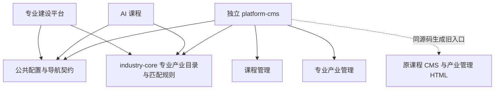

# 第一批架构改造交付说明

> 本文记录原本地综合工作区的交付情况。本次 GitHub 隔离提交的范围与测试结果见 [GitHub 提交说明](./github-update.md)。

日期：2026-11-13。范围：独立 CMS、专业产业公共包、课程构建瘦身。此次基于现有工作区增量修改，保留原有未提交改动，未提交 Git、未部署线上环境。

## 已完成的边界

- `platform-cms` 拥有课程及产业管理源码，可独立开发、构建和部署；业务项目旧管理地址保留，通过同一源码生成兼容页面。
- `packages/industry-core` 统一专业、产业链、多专业恢复与匹配规则，保留 2142 个专业、19 条产业链、791 条关系及其来源说明。专业与岗位 ID、不同教育层次区分、课程任务库行为保持兼容。
- `packages/course-config` 管理课程配置和历史存储键；`packages/data-access` 校验并传递配置、保存返回地址。已有模块及班级路由不会被配置载荷覆盖。
- 课程业务入口不再加载 CMS；线上图片、动画等资源独立输出，离线页面使用单独的 IIFE 构建，继续支持双击打开。
- 课程和产业管理采用视口内布局，列表和弹窗内部滚动，主要操作保持可见。

这批完成的是源码所有权与构建边界拆分。当前仍使用本地浏览器存储和显式配置往返；尚未建立跨设备、多用户的后台配置数据库。专业建设仍保留待逐步删除的旧 Vue 管理分支，正常入口已转到独立 CMS 生成的页面。

## 体积变化

以下使用 MiB（1024² 字节），比较本次开始时产物与最终产物。并非网络首屏耗时或实际压缩传输量。

| 指标 | 开始时 | 本次完成后 | 说明 |
| --- | ---: | ---: | --- |
| 课程在线 JavaScript | 约 27.31 MiB | 4.42 MiB | 统计当前所有在线 JS 分块；大图、动画改为外部资源 |
| 课程旧路径 CMS 离线 HTML | 约 27.61 MiB | 0.83 MiB | 管理页不再携带整套课程业务代码和媒体 |
| 独立 CMS 在线目录 | — | 1.56 MiB | 含课程和产业管理入口及公共分块 |
| 独立产业 CMS 离线 HTML | — | 1.33 MiB | 不依赖业务项目运行中的服务 |

课程完整离线页面仍约 27.58 MiB，以保留完整媒体与离线使用能力。媒体外置降低在线 JS 体积，但资源实际使用时仍会下载，不将其表述为全部流量减少 84%。

## 验证与检查

- 课程、专业建设、独立 CMS 的生产构建均通过；原有大分块及静态经典脚本警告仍存在。
- 课程完整测试：219 项通过。
- 公共包与独立 CMS：32 项通过。覆盖多专业状态、配置校验、存储被拒绝、返回路由及刷新后的配置恢复。
- 专业建设 CMS 及匹配定向测试：47 项通过。
- 生成数据一致性检查 `generate-compat.mjs --check` 通过；最后的离线构建结构检查 2 项通过。
- 浏览器验证独立开发入口、生产入口、课程旧 CMS 入口和专业建设旧管理入口，并实际返回业务页面。已检查 1280×800、768×600、420×700：根页面不滚动，内部区域可滚动，保存操作和弹窗底部按钮可见。
- 学生端两个项目的已跟踪文件差异与改造开始前逐字节一致。

专业建设全量测试最终为 **736 项：694 通过、42 失败**。基线的 41 项失败全部仍在，主要包含外部数据文件缺失、旧静态页面测试未加载 `IndustryChainDescriptions` 等依赖、旧界面断言不一致。本批为静态测试加载了真实 CMS 桥接依赖，并更新旧入口断言。

另外 1 项是缩小 CSS 正则匹配范围后新暴露的旧问题：`job portrait AI summary and cards match the Figma compact card specification` 期望 `.research-figma-ai ul` 的 `gap:10px`，原有样式实际为 `9px`。原正则跨规则误匹配了后面的 `10px`，且会长时间回溯；本次保留原生产样式和测试期望，并明确报告失败。完整失败集合对比见 `.codex-tmp/architecture-batch1/failure-comparison.json`。专业建设全量测试尚未通过。

浏览器工具仅允许 HTTP/HTTPS，未能使用该工具直接打开 `file://` 页面。离线入口由自包含产物检查与文件来源 DOM 测试验证，未据此宣称已完成真实浏览器双击验收。

页面验证截图：[课程产教模型管理](./course-cms-desktop.png)。详细本地记录保存在工作区 `.codex-tmp/architecture-batch1/`。

## 使用与后续

在 `platform-cms` 执行 `npm run dev` 可独立开发。课程和专业建设项目仍使用各自原来的构建命令，旧入口由构建自动同步。部署配置、来源限制及兼容产物更新方式见上级 [README](../README.md)。

下一批可以继续处理专业建设超大入口文件和旧管理分支，再将稳定的配置接口接到统一后端。学生端接入共享目录前需要单独梳理其字段和交互约束，不直接替换其运行时代码。
